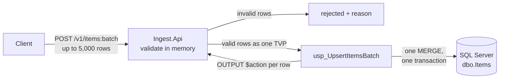
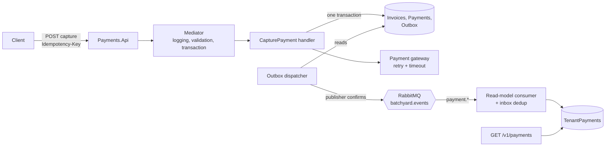

# dotnet-batchyard

[](https://github.com/Arggon/dotnet-batchyard/actions/workflows/ci.yml)
[](https://github.com/Arggon/dotnet-batchyard/actions/workflows/codeql.yml)

A small .NET 10 backend for an invented B2B parts marketplace. It shows, in code you can read in about 15 minutes, the backend work on my CV: batch ingestion over SQL Server, permission models, CQRS payments and pulling a service out of a monolith.

I'm Gonzalo, a senior .NET backend engineer. [Portfolio and CV](https://arggon.github.io/arggon-cv/)

## The headline number

Inserting 5,000 items through the batch endpoint's data path takes **155 ms**. Doing it one item at a time takes **7.6 s**, so the batch path saves **98%** of the time. That number was measured in this repo with BenchmarkDotNet at the data layer. Over HTTP, with JWT auth on, the demo client imports **50,000 items in 1.8 s with batches vs 87 s one at a time (98% less)**. Under concurrent load (k6), batching wrote about **21× more items per second**, both on a cloud VM and on a GitHub Actions runner. None of these runs used production hardware. [Full results, environment and caveats](docs/benchmarks.md)

| Items | one-by-one | batch (TVP + MERGE) | Time saved |
|------:|-----------:|--------------------:|-----------:|
| 100   | 163 ms     | 8 ms                | 95%        |
| 1,000 | 1,357 ms   | 33 ms               | 98%        |
| 5,000 | 7,551 ms   | 155 ms              | 98%        |

## What it shows

| On my CV | In this repo | Status |
|---|---|---|
| Batch endpoint + stored procedure that cut client processing time | `POST /v1/items:batch`: validates in memory, sends one table-valued parameter to a stored procedure, upserts with one set-based `MERGE` | ✅ M1 |
| Spec-first, test-gated delivery with AI agents | Every change starts as a spec and a task under [`ArggonManager/`](ArggonManager/), with tests written first and one small PR per task | ✅ M1 |
| Access roles and permissions that enabled marketplace monetization | Access service: plans grant roles, roles carry permissions and limits. A marketplace subscription webhook grants a restricted `marketplace-seller` role. JWT login, Redis permission cache, authorization matrix tests | ✅ M2 |
| CQRS + mediator in a payments service | Payments service: commands and queries through a hand-written mediator, idempotent capture backed by a unique index, transactional outbox to RabbitMQ, an eventually consistent read model. Access clears its Redis cache when it consumes `plan.changed` | ✅ M3 |
| A .NET microservice extracted from a monolith | YARP gateway moving routes from a legacy app, compared with k6 | 🔜 M4 |

At work these patterns ran on .NET 9. Here they're rebuilt from scratch on .NET 10 with an invented domain, so there's no client code or data.

## Run it

You only need Docker:

```bash
docker compose up --build
```

This starts SQL Server, Redis, RabbitMQ (management UI on port 15672, guest/guest), the access service (port 8081), the ingest service (port 8080) and the payments service (port 8082). It also seeds a demo tenant on the Pro plan, with an API client whose credentials are local-only values from `docker-compose.yml`.

Get a token, then send a batch with one valid and one invalid row:

```bash
TOKEN=$(curl -s -X POST localhost:8081/v1/auth/token -H "Content-Type: application/json" \
  -d '{"clientId":"demo-admin","clientSecret":"local-dev-only-client-secret"}' | jq -r .accessToken)

curl -s -X POST localhost:8080/v1/items:batch \
  -H "Content-Type: application/json" \
  -H "Authorization: Bearer $TOKEN" \
  -d '{"items":[
        {"sku":"BRK-001","name":"Brake pad","price":12.5,"currency":"USD","quantity":40},
        {"sku":"FLT-002","name":"Oil filter","price":-1,"currency":"USD","quantity":3}]}'
```

```json
{ "created": 1, "updated": 0, "rejected": 1,
  "results": [
    { "index": 0, "sku": "BRK-001", "outcome": "created" },
    { "index": 1, "sku": "FLT-002", "outcome": "rejected", "reason": "price must be zero or more" } ] }
```

OpenAPI documents: `http://localhost:8080/openapi/v1.json` (ingest), `http://localhost:8081/openapi/v1.json` (access) and `http://localhost:8082/openapi/v1.json` (payments).

Try a plan change: `PUT localhost:8081/v1/tenants/me/plan` with `{"plan":"Marketplace"}`. Then get a new token and decode it: the batch limit drops to 1,000 and `exports:read` appears.

Pay an invoice, then send the same capture again. The second call replays the first one and charges nothing:

```bash
INVOICE=$(curl -s -X POST localhost:8082/v1/invoices -H "Authorization: Bearer $TOKEN" \
  -H "Content-Type: application/json" -d '{"amount":99.90,"currency":"USD","reference":"PO-1"}' | jq -r .id)

curl -i -X POST localhost:8082/v1/invoices/$INVOICE/capture -H "Authorization: Bearer $TOKEN" -H "Idempotency-Key: pay-1"  # 201
curl -i -X POST localhost:8082/v1/invoices/$INVOICE/capture -H "Authorization: Bearer $TOKEN" -H "Idempotency-Key: pay-1"  # 200, Idempotent-Replayed: true
curl -s localhost:8082/v1/payments -H "Authorization: Bearer $TOKEN"   # history from the read model, filled via RabbitMQ
```

## How the batch path works



- **Partial failure, never partial corruption.** Bad rows are rejected with a reason and good rows commit. A database error rolls back the whole batch.
- **Duplicates inside one batch** are handled in SQL: the first one wins and the rest are reported, so `MERGE` never fails on them.
- **Safe retries.** Send an `Idempotency-Key` header and a retried request gets the original response back. Reusing the key with a different body returns 409.
- **The SQL is code.** Tables, the TVP type and the procedures live in [`db/ingest/`](db/ingest/) and are applied in order by DbUp.

## How access works

| Plan | Roles it grants | What that allows |
|---|---|---|
| Free | viewer, writer | read and single-item writes |
| Pro | + batch-writer | batches up to 5,000 |
| Marketplace | viewer, writer, **marketplace-seller** | batches up to **1,000** + read-only exports |

Admin clients also get `tenant-admin`, which allows changing the plan.

- **Login:** `POST /v1/auth/token` exchanges API client credentials for a 15-minute JWT. The token carries `tenant_id`, `perm` and `max_batch`. Secrets are stored as PBKDF2 hashes, and the endpoint is rate limited.
- **Authorization:** endpoints ask for a permission, not a role (`.RequirePermission("ingest:batch")`). No token → 401, no permission → 403.
- **Tenant:** taken only from the signed token, so nobody can write into another tenant by changing a header.
- **Plan changes** (admin endpoint or the marketplace webhook stub) swap the plan's roles and write a `plan.changed` event to the outbox in the same transaction. Inside Access the Redis permission cache is cleared when that event comes back from RabbitMQ, usually well under a second later. Other services see the change with the next token.
- **The catalog is SQL** in [`db/access/`](db/access/), reviewed like code.

The token is issued locally so the repo runs offline. [ADR 0006](ArggonManager/docs/adr/0006-auth-model-local-jwt-issuer.md) explains how it maps to Cognito, Entra ID or Auth0. Security notes: [SECURITY.md](SECURITY.md).

## How payments work



- **Commands and queries are separate types** sent through a mediator I wrote instead of using MediatR (about 70 lines, plus 90 for the logging, validation and transaction behaviors) ([ADR 0010](ArggonManager/docs/adr/0010-hand-written-mediator.md)). Commands run inside a transaction; queries don't.
- **One charge per key, enforced by the database.** `Payments` has a unique `(TenantId, IdempotencyKey)` index. A retried capture returns the original payment with `200`. Concurrent requests with the same key share one payment. With different keys, the invoice's `rowversion` lets exactly one win; the rest get `409`.
- **The invoice is claimed before the gateway is charged.** A gateway failure rolls everything back and leaves the invoice open (`502`). Transient failures are retried with Polly. The gateway is a fake that is idempotent by key, like Stripe's.
- **Transactional outbox.** The event is written with the payment, in the same transaction. A background dispatcher publishes it and marks it sent only after RabbitMQ confirms it, so delivery is at least once and nothing is lost ([ADR 0011](ArggonManager/docs/adr/0011-transactional-outbox.md)).
- **The read model is eventually consistent.** `GET /v1/payments` reads a flat table filled by a consumer. An inbox table makes redelivered events a no-op ([ADR 0012](ArggonManager/docs/adr/0012-payments-read-model.md)). `GET /v1/invoices/{id}` reads the write side and is always current.
- **Trade-off I chose:** the gateway call happens inside the DB transaction. That's simple and correct for a fast fake. A slow real provider would need a `pending` state instead.

Full system view, now and planned: [docs/architecture.md](docs/architecture.md).

Why it's built this way: [ADR 0001: TVP + MERGE](ArggonManager/docs/adr/0001-batch-upserts-via-tvp-and-merge.md) · [all ADRs](ArggonManager/docs/adr/)

## Tests and quality gates

- **Unit tests** for the validation rules
- **Integration tests against real SQL Server 2022, Redis and RabbitMQ** started by Testcontainers, with no database mocks: the stored procedure, the TVP, duplicates, a 5,000-row batch, plan changes, the permission cache, and the HTTP endpoints end to end
- **Authorization matrices** as data-driven xUnit theories: role × endpoint → expected status, for both services. The ingest matrix reads each role from the real access catalog
- **Payments tests:** unit tests for the mediator pipeline and handlers, plus integration tests against SQL Server and RabbitMQ: double capture, concurrent captures with the same key and with different keys, gateway retries and outages, refund, the outbox reaching the read model, inbox dedup
- **Architecture tests** (NetArchTest): data layers can't depend on APIs, the payments application layer knows nothing about SQL, HTTP or RabbitMQ, and the messaging library knows no service
- **CI on every PR:** build with warnings as errors, `dotnet format` check, all tests, a `docker compose` smoke test (batch import, idempotent capture, read model updated through RabbitMQ), merged code coverage on the job page, CodeQL and `arggon validate`. A k6 load test runs on demand

```bash
dotnet test   # needs Docker for the integration tests
```

## Stack

.NET 10 · ASP.NET Core Minimal APIs · SQL Server 2022 · Dapper · EF Core · DbUp · JWT · Redis · RabbitMQ · Polly · xUnit + Shouldly · Testcontainers · BenchmarkDotNet · k6 · Docker Compose · GitHub Actions

## How it was built

This repo is built with [ArggonManager](https://github.com/Arggon/ArggonManager), a method and CLI I designed for shipping software with AI agents. Agents plan, implement, review and verify; I'm the product owner. In practice:

- **Agents wrote most of the code, tests and docs.**
- **I designed the method, wrote or approved the specs and ADRs, review every PR and decide what gets merged.**

Each feature goes spec → plan → tasks → test-first commits → review → merge. The trail is in [`ArggonManager/`](ArggonManager/) and in the PR history. More in [docs/agentic-workflow.md](docs/agentic-workflow.md).

## Repo map

```
src/Ingest.Api          Minimal API: endpoints, validation, idempotency
src/Ingest.Data         Dapper repository + DbUp migrator
src/Access.Api          Token endpoint, tenant/plan endpoints, marketplace webhook stub
src/Access.Data         EF Core model, plan changes, Redis permission cache
src/Payments.Api        Invoice, capture, refund and history endpoints
src/Payments.Application  Mediator, pipeline behaviors, commands, queries, domain (no SQL, no HTTP)
src/Payments.Data       Dapper repositories, outbox writer, read-model consumer, fake gateway
src/BuildingBlocks      Shared JWT validation and the permission filter (no framework)
src/BuildingBlocks.Messaging  Outbox dispatcher, RabbitMQ publisher (confirms) and consumer
db/ingest, db/access, db/payments  Versioned SQL: tables, TVP type, procedures, catalog, outbox
tests/                  Unit, integration (Testcontainers) and architecture tests
benchmarks/             BenchmarkDotNet + k6
tools/Ingest.DemoClient 50,000-item import, one-by-one vs batch
ArggonManager/          Specs, plans, tasks, ADRs, playbooks
docs/                   Architecture, benchmarks, agentic workflow
```

## Roadmap

- **M1, done:** skeleton, CI with coverage, compose, ingest batch endpoint, integration tests, BenchmarkDotNet + demo client + k6 numbers, architecture diagrams
- **M2, done:** access service with plans, roles and permissions, JWT login, authorization matrices, Redis cache. Ingest now takes the tenant from the token
- **M3, done:** payments service with commands and queries, a hand-written mediator, idempotent capture, outbox + RabbitMQ, a read model. Access clears its cache on `plan.changed`
- **M4:** legacy monolith + YARP strangler + k6, OpenTelemetry

## License

[MIT](LICENSE)
