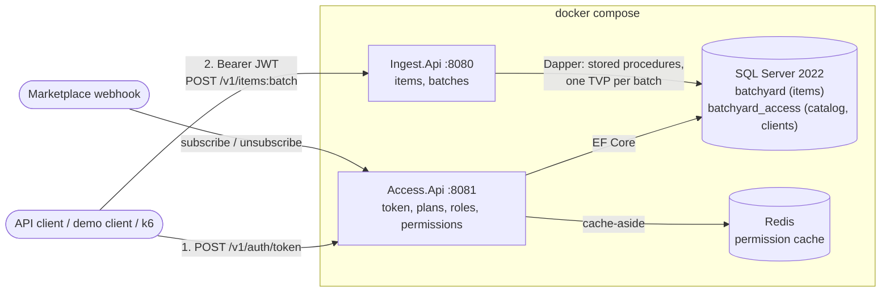
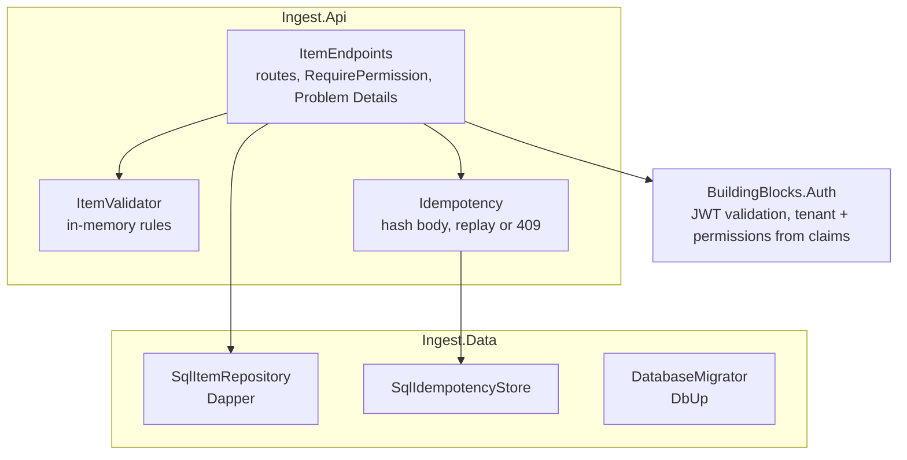
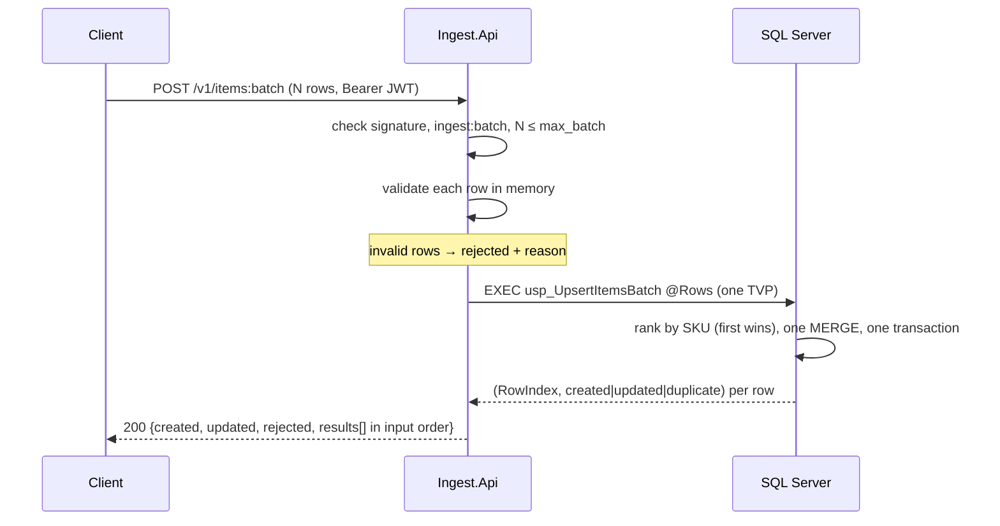
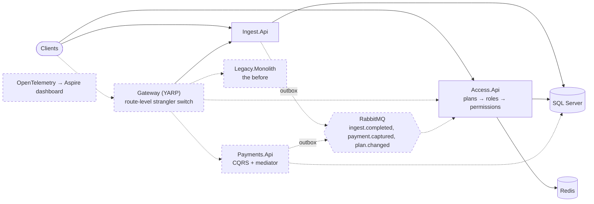

# Architecture

Two views: the system as it is today (milestone 1), and the full target from the roadmap. Solid boxes exist in the code; dashed boxes are planned.

## Today (M2)

Ingest never calls Access. It validates the token's signature and reads `tenant_id`, `perm` and `max_batch` from it (ADR 0006).

### Inside the ingest service

`Ingest.Data` must not depend on `Ingest.Api` or ASP.NET Core. `tests/Architecture.Tests` enforces this rule.

### One batch request

## Target (M4)

| Milestone | Adds |
|---|---|
| M1 ✅ | Ingest service, SQL Server, compose, CI |
| M2 ✅ | Access service, JWT, Redis permission cache |
| M3 | Payments service, mediator, outbox + RabbitMQ, read model |
| M4 | Legacy monolith, YARP gateway, OpenTelemetry |

Decisions behind these choices are in [ArggonManager/docs/adr](../ArggonManager/docs/adr/).
