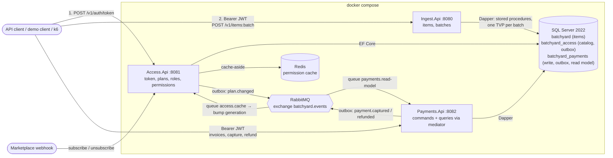
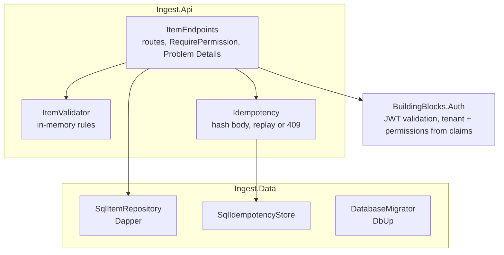
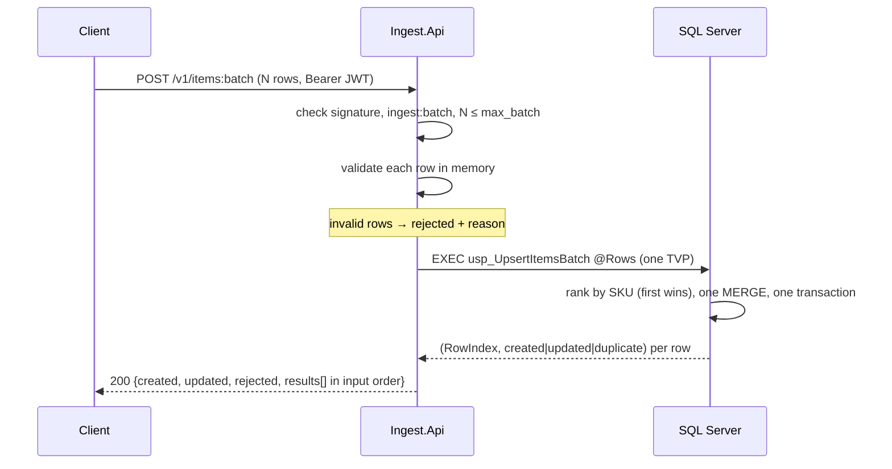
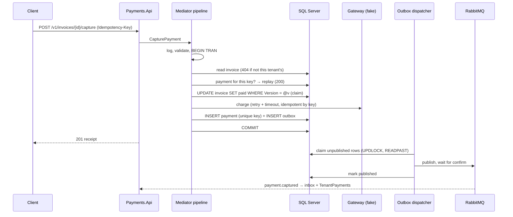
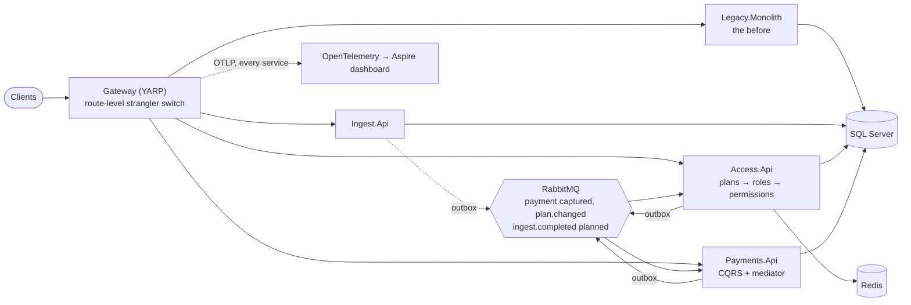

# Architecture

Two views: the system as it is today (milestone 3), and the full target from the roadmap. Solid boxes exist in the code; dashed boxes are planned.

## Today (M3)

Ingest never calls Access. It validates the token's signature and reads `tenant_id`, `perm` and `max_batch` from it (ADR 0006).

### Inside the ingest service

`Ingest.Data` must not depend on `Ingest.Api` or ASP.NET Core. `tests/Architecture.Tests` enforces this rule.

### One batch request

### Inside the payments service

`Payments.Application` holds the mediator, handlers and domain, and has no reference to SQL, HTTP or RabbitMQ. `tests/Architecture.Tests` enforces that, and also that `BuildingBlocks.Messaging` knows no service.

## Target (M4)

| Milestone | Adds |
|---|---|
| M1 ✅ | Ingest service, SQL Server, compose, CI |
| M2 ✅ | Access service, JWT, Redis permission cache |
| M3 ✅ | Payments service, mediator, outbox + RabbitMQ, read model, plan.changed |
| M4 ✅ | Legacy monolith, YARP gateway, k6 comparison, OpenTelemetry |

Decisions behind these choices are in [ArggonManager/docs/adr](../ArggonManager/docs/adr/).
